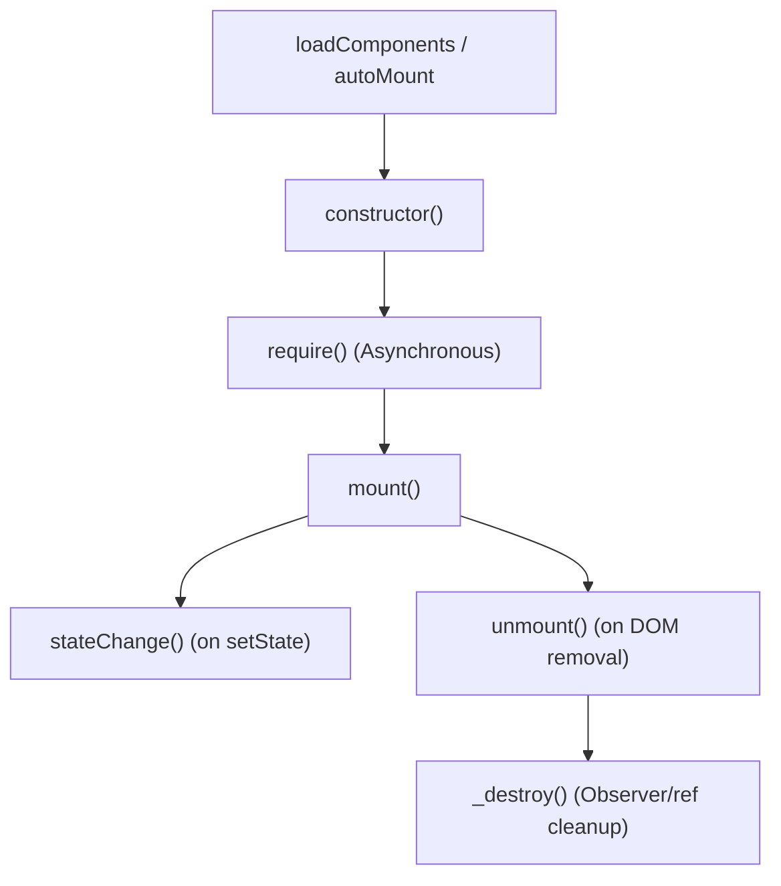

# Gia

A performance-first, ultra-lightweight JavaScript framework (~5KB gzipped) for creating **Islands of Interactivity** on server-rendered (WordPress, Django, Rails, Laravel, Astro) or static websites. It provides the clean lifecycle, state management, and declarative event binding of modern SPA frameworks without the heavy bundle size or Virtual DOM overhead.

[](LICENSE)
[-blue?style=flat-square>)](dist/gia.full.umd.js)

_Note: This is an optimized fork of the original Gia framework. It contains numerous performance enhancements, custom examples, and robust memory management._

---

### Why Gia?

1. **Ultra-Lightweight & Fast**: Practically invisible on the network. Built using native Web APIs (like `EventTarget` for the global event bus) and optimized to minimize memory allocations.
2. **Solves "Vanilla JS Spaghetti"**: Traditional multi-page sites struggle with messy event listeners and memory leaks. Gia's strict lifecycle (`mount`, `require`, `unmount`) ensures automatic cleanup when elements leave the DOM.
3. **Zero-GC Hot Paths**: Hand-optimized to avoid garbage collection spikes and layout thrashing. Perfect for high-frequency events (scrolling, resizing, drag-and-drop, and interactive canvases).
4. **Built-in DX Features**: Comes with pre-indexed references (`data-ref`), declarative event mapping (`data-action`), unified observers, and asynchronous script/style loading out-of-the-box.

---

## Table of Contents

- [Installation & Build Variants](#installation--build-variants)
- [Quick Start](#quick-start)
- [Component Lifecycle](#component-lifecycle)
- [Core Concepts](#core-concepts)
    - [The Ref System (`this.ref`)](#the-ref-system-thisref)
    - [State & Reactivity (`this.setState`)](#state--reactivity-thissetstate)
    - [AbortSignal & Auto-Cleanup (`this.signal`)](#abortsignal--auto-cleanup-thissignal)
    - [Centralized Observers](#centralized-observers)
    - [On-Demand Dependencies (`require`)](#on-demand-dependencies-require)
    - [Global Eventbus](#global-eventbus)
- [Mounting Ergonomics & Registry](#mounting-ergonomics--registry)
    - [Zero-Boilerplate Auto-Discovery (`loadComponents`)](#zero-boilerplate-auto-discovery-loadcomponents)
    - [Named Component Registration (`register`)](#named-component-registration-register)
    - [Component Mounting Priority](#component-mounting-priority)
    - [Context & Component Unmounting (`removeComponents`)](#context--component-unmounting-removecomponents)
- [Cross-Bundle & UMD Idempotency](#cross-bundle--umd-idempotency)
- [Quality of Life Features](#quality-of-life-features)
    - [Component Options (`data-options`)](#component-options-data-options)
    - [Event Binding (`data-action`)](#event-binding-data-action)
    - [Auto-Mounting](#auto-mounting)
- [TypeScript Support](#typescript-support)
- [Global Configuration](#global-configuration)
- [API Reference](#api-reference)
- [Performance Optimizations](#performance-optimizations)
- [Interactive Examples](#interactive-examples)
- [Integration with Swup](#integration-with-swup)
- [Integration with Lenis](#integration-with-lenis)

---

## Installation & Build Variants

Gia is compiled into three highly optimized build variants depending on the features you need. Load the UMD builds directly via script tag, or import the ESM (`.mjs`) builds via clean subpath imports.

| Build Variant  | Subpath Import | Description | UMD Gzip (Raw) | ESM Gzip (Raw) |
| -------------- | -------------- | ----------- | -------------- | -------------- |
| **Full Build** | `import { Component } from "gia"` | All framework features: async `require()`, auto-mounting, observers, and EventBus. | ~6.8 KB (20.4 KB) | ~6.7 KB (20.3 KB) |
| **Mini Build** | `import { BaseComponent } from "gia/mini"` | Drops `autoMount` MutationObserver and `data-action` auto-binding. | ~6.2 KB (18.6 KB) | ~6.1 KB (18.4 KB) |
| **Nano Build** | `import { BaseComponent } from "gia/nano"` | Bare minimum: drops EventBus, global observers, JSON options parsing, and async script loading. Just the core class and ref engine. | ~3.6 KB (9.9 KB) | ~3.5 KB (9.7 KB) |

```javascript
// Full build with modern ESM
import { Component, loadComponents, register, eventbus } from "gia";

// Or target the tiny Nano build (~3.4 KB gzipped)
import { BaseComponent, loadComponents, register } from "gia/nano";
```

```html
<!-- Example: Loading the full build via script tag -->
<script src="./dist/gia.full.umd.js"></script>

<!-- Or enable declarative zero-JS auto-mounting directly on the script tag! -->
<script src="./dist/gia.full.umd.js" data-auto-mount></script>
```

> [!TIP]
> **UMD Superpowers & Head-Loading Safety**:
> - **Non-Destructive UMD Merging**: All UMD builds compile with `output.extend: true`. Third-party widgets and host pages merge cleanly onto `window.gia` without wiping previously loaded components or features.
> - **Head-Safe Execution**: `loadComponents()` can be called in `<head>`, inline, or with `<script defer>`. If the DOM is still loading (`document.readyState === "loading"`), Gia automatically defers execution to `DOMContentLoaded`.
> - **Global Window Auto-Discovery**: Components declared as global classes (`class Counter extends gia.Component`) in plain `<script>` tags are automatically resolved from `window[componentName]` without needing manual registration.

---

## Quick Start

### 1. Define the HTML markup

Mark the root element with `data-component` and assign `data-ref` to any child elements you need to interact with.

```html
<div class="counter" data-component="Counter">
	<button class="button" data-ref="decrementBtn" aria-label="Decrease">-</button>
	<output class="display" data-ref="display">0</output>
	<button class="button" data-ref="incrementBtn" aria-label="Increase">+</button>
</div>
```

### 2. Implement the component

```javascript
import { Component } from "gia";

class Counter extends Component {
	constructor(element) {
		super(element);

		this.ref = {
			display: null,
			incrementBtn: null,
			decrementBtn: null,
		};

		this.setState({ count: 0 });
	}

	mount() {
		// Component methods are automatically bound to `this`
		// Using this.signal guarantees automatic cleanup when the element unmounts!
		this.ref.incrementBtn.addEventListener("click", this.increment, { signal: this.signal });
		this.ref.decrementBtn.addEventListener("click", this.decrement, { signal: this.signal });

		// Initial render
		this.ref.display.textContent = this.state.count;
	}

	increment() {
		this.setState({ count: this.state.count + 1 });
	}

	decrement() {
		this.setState({ count: this.state.count - 1 });
	}

	// Automatically called in the next animation frame when state changes
	stateChange(changes) {
		if ("count" in changes) {
			this.ref.display.textContent = this.state.count;
		}
	}
}
```

### 3. Load and register your components

```javascript
import { register, loadComponents } from "gia";

// Approach A: Global registry with zero-argument auto-discovery
register(Counter);
loadComponents(); // Discovers and mounts all registered components across the page

// Approach B: Explicit dictionary scoping
loadComponents({ Counter });
```

---

## Component Lifecycle



Gia components follow a strict lifecycle designed to optimize rendering performance and prevent memory leaks:

1. **`constructor(element)`**: Sets up defaults, defines `this.ref` targets, and sets initial state.
2. **`require()` (Async)**: _Available on `Component` (not `BaseComponent`)_. Performs on-demand script or style loading. Mount is deferred until this resolves.
3. **`mount()`**: Executes after constructor and dependencies are resolved. Bind custom events, construct third-party libraries, and bootstrap interactions here. **Bonus**: `mount()` can optionally return a cleanup function (e.g. `return () => clearInterval(timer)`), which executes automatically upon unmount.
4. **`stateChange(changes)`**: Invoked inside `requestAnimationFrame` when state values change.
5. **`unmount()`**: Runs when the component is destroyed (e.g. element removed from DOM). Clean up custom event listeners, timelines, or third-party instances here.
6. **`_destroy()`**: Internal lifecycle step. Aborts `this.signal`, calls mount cleanup, runs `unmount()`, unsubscribes all unified observers, and disconnects elements from memory.

---

## Core Concepts

### The Ref System (`this.ref`)

Instead of writing repetitive `document.querySelector` statements, Gia pre-indexes elements containing `data-ref` inside your component's root context.

#### Configuration Rules

- Set reference keys to `null` to resolve to a **single element**.
- Set reference keys to `[]` to resolve to an **array of elements**.
- Set `this.ref` to an empty object `{}` to automatically grab all refs as arrays.

```html
<div data-component="Gallery">
	<button data-ref="prev">Previous</button>
	<button data-ref="next">Next</button>
	<div data-ref="slides">Slide 1</div>
	<div data-ref="slides">Slide 2</div>
</div>
```

```javascript
class Gallery extends Component {
	constructor(element) {
		super(element);
		this.ref = {
			prev: null, // Single HTMLElement
			next: null, // Single HTMLElement
			slides: [], // Array of HTMLElements
		};
	}
}
```

> [!TIP]
> **Nested Component Isolation & Namespacing**:
> By default, Gia isolates references: an element with `data-ref="btn"` is strictly bound to its closest ancestor component. A parent component will **never** accidentally capture child component refs or actions.
> If a parent component needs to deliberately target an element nested inside a child component, prefix the ref with the parent component's class name: `<div data-ref="ParentComponent:nestedItem">`.

---

### State & Reactivity (`this.setState`)

State should be mutated using `this.setState()`. When state properties change, Gia queues a callback to `stateChange()` in the next animation frame, preventing layout thrashing. `this.setState` accepts an object or a functional updater to prevent race conditions during rapid state transitions:

```javascript
// Object syntax
this.setState({ activeTab: 2 });

// Functional updater syntax (safe against stale closure race conditions)
this.setState((prevState) => ({ count: prevState.count + 1 }));
```

#### State-to-Attribute Auto-binding

Gia automatically serializes primitive state properties (`boolean` and `string` types) into `data-` attributes on the root element. CamelCase state keys are translated to kebab-case:

- `isOpen: true` ➔ `data-is-open="true"`
- `status: "loading"` ➔ `data-status="loading"`

This allows you to control component styling entirely through CSS, removing the need for verbose class-toggling code:

```css
[data-component="Sidebar"] {
	transform: translateX(-100%);
	transition: transform 0.3s cubic-bezier(0.16, 1, 0.3, 1);
}
[data-component="Sidebar"][data-is-open="true"] {
	transform: translateX(0);
}
```

---

### AbortSignal & Auto-Cleanup (`this.signal`)

Every Gia component provides a lazily instantiated `AbortSignal` via `this.signal` that is automatically aborted whenever the component unmounts. This completely eliminates manual event listener cleanup and memory leaks.

#### 1. Zero-Boilerplate Event Listeners
Modern browser DOM APIs accept `{ signal }` in `addEventListener`. When the component element is removed from the DOM, all listeners bound with `this.signal` are instantly detached by the browser engine without needing manual `removeEventListener()` calls:

```javascript
class KeyboardNav extends Component {
	mount() {
		// Automatically removed when this component unmounts!
		window.addEventListener("keydown", this.handleKey, { signal: this.signal });
		document.addEventListener("pointermove", this.handleMove, { signal: this.signal });
	}
}
```

#### 2. Auto-Canceling Async Operations
Pass `this.signal` to `fetch()` or async APIs to cancel in-flight network requests if the component is unmounted before the response arrives:

```javascript
class ProductCard extends Component {
	async mount() {
		try {
			const res = await fetch(`/api/products/${this.options.id}`, { signal: this.signal });
			const data = await res.json();
			this.setState({ data });
		} catch (err) {
			if (err.name === "AbortError") return; // Cleanly handled cancellation
			console.error(err);
		}
	}
}
```

#### 3. Returning a Cleanup Function from `mount()`
Similar to React `useEffect` or Svelte, `mount()` can optionally return a cleanup function. Gia calls this cleanup function right before `unmount()`:

```javascript
class LiveClock extends Component {
	mount() {
		const timer = setInterval(this.tick, 1000);
		// Automatically executed on unmount
		return () => clearInterval(timer);
	}
}
```

#### 4. Checking Mount State (`this.isMounted`)
Inspect `this.isMounted` (boolean) to safely guard asynchronous callbacks from touching state or DOM after an element has left the page:

```javascript
if (this.isMounted) {
	this.setState({ loaded: true });
}
```

---

### Centralized Observers

Instantiating multiple `IntersectionObserver` or `ResizeObserver` instances can lead to severe browser performance bottlenecks. Gia shares centralized, global observer instances and window listeners across all components. It also handles automatic unsubscription during the `unmount` phase, ensuring zero memory leaks.

Gia provides four primary observer APIs built directly into `BaseComponent`:

#### 1. Intersection (`observeIntersection`)

Instead of each component creating its own `IntersectionObserver`, Gia groups elements by their observer options (like `threshold` and `rootMargin`) and monitors them using a shared, global observer.

- **Usage**: `this.observeIntersection(element, callback, options)`
- **Best for**: Lazy-loading images, scroll-triggered animations (like `Reveal`), and pausing heavy tasks (like canvas physics) when out of view.

#### 2. Element Resize (`observeResize`)

Monitors changes to an element's dimensions using a single, globally shared `ResizeObserver`.

- **Usage**: `this.observeResize(element, callback)`
- **Best for**: Responsive components, canvas resizing, and custom text-scaling utilities (like `TextFit`).

#### 3. Global Scroll (`observeScroll`)

Attaches to a single centralized window scroll listener. Instead of forcing the browser to synchronously recalculate layout by reading `window.scrollY` inside your callback, Gia passes a pre-calculated `payload` containing the current scroll position and velocity.

- **Usage**: `this.observeScroll((payload) => console.log(payload.scroll, payload.velocity))`
- **Bonus**: If the popular [Lenis](https://lenis.studiofreight.com/) smooth scroll library is detected globally (`window.lenis`), Gia automatically hooks into its optimized `requestAnimationFrame` scroll tick instead of the native DOM scroll event.

#### 4. Window Resize (`observeWindowResize`)

Attaches to a single centralized window resize listener (or `orientationchange` on mobile browsers) to prevent multiple components from binding heavy resize events simultaneously.

- **Usage**: `this.observeWindowResize((payload) => console.log(payload.width, payload.height))`

**Example implementation:**

```javascript
class TrackingComponent extends Component {
	mount() {
		this.observeIntersection(this.element, this.handleIntersection, { threshold: 0.5 });
		this.observeResize(this.element, this.handleElementResize);
		this.observeScroll(this.handleScroll);
		this.observeWindowResize(this.handleWindowResize);
	}

	handleIntersection([entry]) {
		if (entry.isIntersecting) {
			entry.target.classList.add("in-view");
		}
	}

	handleElementResize([entry]) {
		console.log("Element width:", entry.contentRect.width);
	}

	handleScroll(payload) {
		// Safely read from payload to avoid layout thrashing!
		this.element.style.transform = `translateY(${payload.scroll * 0.5}px)`;
	}

	handleWindowResize(payload) {
		console.log("Window bounds:", payload.width, payload.height);
	}
}
```

---

### DOM Scheduling (Measure & Mutate)

To completely eliminate layout thrashing (forced synchronous layouts), Gia includes a built-in DOM scheduler inspired by [FastDOM](https://github.com/wilsonpage/fastdom). It batches all DOM reads and writes across your entire application into a single `requestAnimationFrame` loop.

```javascript
class Tooltip extends Component {
	align() {
		// 1. Measure phase: Read from the DOM
		this.task = gia.measure(() => {
			const targetRect = this.target.getBoundingClientRect();
			const tooltipRect = this.element.getBoundingClientRect();

			const left = targetRect.left + (targetRect.width / 2) - (tooltipRect.width / 2);

			// 2. Mutate phase: Write to the DOM
			gia.mutate(() => {
				this.element.style.transform = `translateX(${left}px)`;
				this.element.style.opacity = "1";
			});
		});
	}

	unmount() {
		// Cancel scheduled tasks if the component is destroyed before the frame executes
		gia.clear(this.task);
	}
}
```

By forcing components to use `gia.measure()` for reading dimensions and `gia.mutate()` for applying styles, it is mathematically impossible for components to accidentally trigger Write-then-Read layout thrashing. The scheduler guarantees that all Reads across the entire page execute before any Writes on the next frame.

---

### On-Demand Dependencies (`require`)

Keep your initial bundle size tiny by lazy-loading heavy third-party dependencies only when a component that actually needs them is present on the page.

To use `loadScript` and `loadStyle`, you must place the `<script>` and `<link>` tags in your HTML with `data-src` and `data-href` attributes instead of standard `src`/`href`. Gia locates the tag by its `id`, safely triggers the network request, and returns a Promise.

Gia handles concurrency automatically: if five components request the same script simultaneously, Gia only downloads it once and resolves all component promises when it finishes.

```html
<!-- Place these in your <head> or at the bottom of the body -->
<link id="floating-ui-css" rel="stylesheet" data-href="/path/to/floating-ui.css" />
<script id="floating-ui-js" data-src="/path/to/floating-ui.js"></script>
```

```javascript
class Tooltip extends Component {
	async require() {
		// loadScript(scriptId, expectedGlobalVariable)
		// loadStyle(styleId)
		await Promise.all([this.loadScript("floating-ui-js", "FloatingUI"), this.loadStyle("floating-ui-css")]);
	}

	mount() {
		// Dependencies are fully loaded and injected before mount() runs
		console.log(window.FloatingUI);
	}
}
```

---

### Global Eventbus

Decouple your components by communicating through a global, zero-GC event bus.

```javascript
import { eventbus } from "gia";

// Component A (Emitter)
eventbus.emit("productAdded", { id: 101, name: "Premium Widget" });

// Component B (Receiver)
// Automatically unbinds when this component unmounts via this.signal!
class CartPreview extends Component {
	mount() {
		eventbus.on("productAdded", this.handleProductAdded, { signal: this.signal });
	}

	handleProductAdded(data) {
		console.log(`Updating cart with product: ${data.name}`);
	}
}
```

---

## Mounting Ergonomics & Registry

Gia offers flexible, zero-friction patterns for registering, mounting, prioritizing, and unmounting components across pages, asynchronous containers, and PJAX/Swup transitions.

### Zero-Boilerplate Auto-Discovery (`loadComponents`)

You can invoke `loadComponents()` without arguments. Gia will automatically discover all registered components across the entire document. You can also pass a container element as the only argument to scope auto-discovery to that container:

```javascript
import { register, loadComponents } from "gia";

// 1. Register components globally
register(Header);
register(Modal);

// 2. Mount across the entire page (zero arguments)
loadComponents();

// Or scope auto-discovery to an injected container or AJAX fragment:
const fragment = document.querySelector("#cart-flyout");
loadComponents(fragment);
```

### Named Component Registration (`register`)

The `register()` helper makes components globally discoverable via `window.gia.components` and optionally sets their mounting priority:

```javascript
import { register } from "gia";
import { ImageHolder } from "./ImageHolder.js";

// Basic registration (uses class name ImageHolder)
register(ImageHolder);

// Register with mounting priority
register(ImageHolder, { priority: 100 });
```

### Component Mounting Priority

By default, Gia parses the DOM and mounts components in natural top-to-bottom order. However, if critical components must initialize first (e.g. layout calculators, hero sliders, or analytics), you can specify a mounting priority:

**Option 1: Using `register` (Recommended)**
```javascript
import { register, loadComponents } from "gia";

register(ImageHolder, { priority: 100 });
register(HeroSlider, { priority: 50 });
register(AnalyticsTracking); // defaults to priority 0

loadComponents();
```

**Option 2: Using Class Statics**
```javascript
class ImageHolder extends Component {
	static priority = 100;

	mount() {
		// Runs before lower-priority components!
	}
}
```

Components with identical priorities safely preserve their natural DOM order.

### Context & Component Unmounting (`removeComponents`)

When using client-side routers (like Swup, Barba.js, Turbo) or dynamically removing DOM nodes, `removeComponents()` cleanly tears down all component instances, fires their `unmount()` lifecycle methods, aborts their `this.signal` controllers, and removes all references.

You can pass a container DOM element, or pass `(components, context)` interchangeably:

```javascript
import { removeComponents } from "gia";

// Unmount all Gia components inside a container before replacing it
const container = document.querySelector("#swup-container");
removeComponents(container);
```

---

## Cross-Bundle & UMD Idempotency

When integrating Gia into complex architectures, micro-frontends, design systems, or third-party embeddable widgets, multiple bundles or scripts may coexist on the same page. Gia is built from the ground up to be 100% idempotent and crash-proof in multi-bundle environments:

1. **Shared Universal Instance Store (`window.__gia_store__`)**:
   Component instances are tracked in a shared `WeakMap` singleton attached to `globalThis.__gia_store__`. Even if the main page imports `gia/mini` and a third-party widget imports its own bundled `gia/nano`, an element will **never be double-mounted**, and calls to `getComponentFromElement()` retrieve the correct instance across bundle boundaries.

2. **Shared Animation & Batch Scheduler (`window.__gia_scheduler__`)**:
   FastDOM `measure()` and `mutate()` operations share a unified frame-loop queue. Multiple bundles cooperate within a single `requestAnimationFrame` tick, eliminating layout thrashing and animation stutter.

3. **Shared Universal Event Bus (`window.__gia_eventbus__`)**:
   The `eventbus` emitter is shared globally across all bundles via `globalThis.__gia_eventbus__`. Micro-frontends or third-party embeddable widgets importing different Gia bundles can communicate seamlessly via `eventbus.emit()` and `eventbus.on()`.

4. **Non-Destructive UMD Merging (`extend: true`)**:
   All UMD builds (`gia.full.umd.js`, `gia.mini.umd.js`, `gia.nano.umd.js`) compile with Rollup/Vite's `extend: true` flag (`globalThis.gia = globalThis.gia || {}`). Loading a nano widget script tag on a page that already loaded the full Gia library will **never overwrite** `gia.Component`, `gia.eventbus`, or existing registered components.

---

## Quality of Life Features

### Component Options (`data-options`)

You can pass configuration options directly from HTML into your component via the `data-options` attribute. The attribute must contain valid JSON. Gia parses this and merges it with default options defined in your constructor.

```html
<div data-component="Slider" data-options='{"speed": 500, "loop": true}'>
	<!-- Slider content -->
</div>
```

```javascript
class Slider extends Component {
	constructor(element) {
		super(element);

		// Define defaults and merge with `data-options`
		this.options = {
			speed: 300,
			loop: false,
		};
	}

	mount() {
		console.log(this.options.speed); // 500
		console.log(this.options.loop); // true
	}
}
```

---

### Event Binding (`data-action`)

By setting `config.set("autoBindActions", true)`, Gia parses `data-action` attributes and automatically binds matching component methods as event listeners, eliminating the need to manually attach and clean up standard event listeners in `mount()`.

**Format**: `data-action="eventName->methodName"` (separate multiple events with spaces).

```html
<div data-component="InteractiveCard">
	<div data-action="mouseenter->handleEnter mouseleave->handleLeave">Hover Me</div>
	<button data-action="click->handleClick">Click Me</button>
</div>
```

```javascript
class InteractiveCard extends Component {
	handleEnter(event) {
		event.currentTarget.classList.add("hovered");
	}
	handleLeave(event) {
		event.currentTarget.classList.remove("hovered");
	}
	handleClick(event) {
		console.log("Card clicked!", event.currentTarget);
	}
}
```

> [!IMPORTANT]
> **Best Practice**: Always use `event.currentTarget` instead of `event.target` in event handlers. `event.currentTarget` is guaranteed to point to the element containing the `data-action` attribute, preventing issues when users click on nested elements (such as icons or text spans).

---

### Auto-Mounting

By default, components are loaded manually with `loadComponents()`. By enabling `config.set("autoMountComponents", true)`, Gia uses a `MutationObserver` to automatically detect newly injected HTML and mount or unmount instances automatically.

```javascript
import { config, register, loadComponents } from "gia";

config.set("autoMountComponents", true);
register(MyComponent);
loadComponents();

// Anytime `<div data-component="MyComponent">` is added to the DOM, it mounts automatically.
// Example: document.body.innerHTML += '<div data-component="MyComponent">Dynamically Injected</div>';
```

---

## TypeScript Support

Gia ships with full, native TypeScript type declarations (`types/index.d.ts`, `types/mini.d.ts`, and `types/nano.d.ts`) supporting generic component types for **State**, **Options**, and **Refs**:

```typescript
import { BaseComponent, Component, loadComponents } from "gia";

interface CounterState {
	count: number;
}

interface CounterOptions {
	step: number;
}

interface CounterRefs {
	incrementBtn: HTMLButtonElement;
	decrementBtn: HTMLButtonElement;
	display: HTMLOutputElement;
}

export default class Counter extends BaseComponent<CounterState, CounterOptions, CounterRefs> {
	mount() {
		this.setState({ count: 0 });

		// Fully typed refs and options with autocompletion!
		this.ref.incrementBtn.addEventListener("click", () => {
			this.setState({ count: this.state.count + this.options.step });
		}, { signal: this.signal });

		// Return optional cleanup function
		return () => {
			console.log("Counter unmounted!");
		};
	}

	stateChange(changes: Partial<CounterState>) {
		if (changes.count !== undefined) {
			this.ref.display.textContent = String(changes.count);
		}
	}
}

// Type-checked component registry
loadComponents({ Counter });
```

---

## Global Configuration

Customize the framework's behavior using the global `config` object:

```javascript
import { config } from "gia";

// Toggle console logging and warning messages
config.set("log", true);

// Customize data attribute prefix (e.g. 'g' searches for 'g-component' instead of 'data-component')
config.set("attrPrefix", "data");

// Enable MutationObserver to automatically mount and unmount components on DOM tree changes
config.set("autoMountComponents", true);

// Toggle automatic binding of data-action attributes
config.set("autoBindActions", true);
```

---

## API Reference

### Global Exports

- **`loadComponents([components], [context])`**: Discovers and mounts components. Supports zero-boilerplate calling:
  - `loadComponents()` — mounts all registered components across `document.documentElement`.
  - `loadComponents(container)` — scopes auto-discovery of all registered components to `container`.
  - `loadComponents(components, [context])` — mounts an explicit dictionary of components scoped to `context` (defaults to `document.documentElement`).
- **`register(ComponentClass, [options])`**: Registers a component class globally in `window.gia.components` with an optional `{ priority: number }`.
- **`removeComponents([components], [context])`**: Destroys and cleans up all component instances inside the target context. Accepts `removeComponents(container)` or `removeComponents(components, context)` interchangeably.
- **`createInstance(element, componentName, ComponentClass, [options])`**: Manually attaches and mounts a component instance on a DOM element.
- **`destroyInstance(element)`**: Dismantles a component instance, triggering its `unmount()` lifecycle, aborting `this.signal`, and cleaning memory references.
- **`getComponentFromElement(element)`**: Retrieves the active component instance associated with a DOM node or an element ID string.
- **`eventbus`**: Unified `EventTarget`-based event emitter with zero allocations. Methods:
  - `eventbus.emit(event, data)`: Emits an event with optional payload.
  - `eventbus.on(event, handler, [options])`: Attaches an event listener. Supports `{ signal, once }`.
- **`measure(callback, [context])`**: Schedules a DOM read operation for the next frame's measure phase. Returns a task reference.
- **`mutate(callback, [context])`**: Schedules a DOM write operation for the next frame's mutate phase. Returns a task reference.
- **`clear(task)`**: Cancels a scheduled measure or mutate task.
- **`config`**: Global configuration manager. Methods: `config.get(key)`, `config.set(key, value)`.

### BaseComponent API

- **`element`**: The root DOM element that this component instance is attached to.
- **`ref`**: Automatically mapped child DOM references matching `data-ref="name"` (single element) or `data-ref="name[]"` (array of elements).
- **`getRef(refName, [all])`**: Dynamically queries refs scoped strictly to this component element (without querying into nested child components).
- **`options`**: Parsed configuration options passed via `data-options='{...}'`, automatically merged with constructor defaults.
- **`signal`**: Lazily instantiated native `AbortSignal` that automatically aborts on component destruction. Pass to `addEventListener(..., { signal: this.signal })` or `fetch()` for zero-leak cleanup.
- **`isMounted`**: Read-only boolean property indicating whether the component is currently mounted in the DOM.
- **`state`**: Read-only snapshot of component state.
- **`setState(changes)`**: Batches state modifications and queues a DOM re-render in the next animation frame. Can be called safely inside the constructor or during `mount()`.
- **`stateChange(stateChanges)`**: Lifecycle hook called automatically after a batched `setState()` re-render, receiving an object with the changed properties.
- **`mount()`**: Lifecycle hook invoked after DOM refs, options, and actions are bound. Can optionally return a teardown/cleanup function.
- **`unmount()`**: Lifecycle hook invoked when the component is destroyed.
- **`observeIntersection(element, callback, [options])`** / **`unobserveIntersection(element, callback)`**: Subscribes/unsubscribes to a shared IntersectionObserver pool.
- **`observeResize(element, callback)`** / **`unobserveResize(element, callback)`**: Subscribes/unsubscribes to a shared ResizeObserver pool.
- **`observeScroll(callback)`** / **`unobserveScroll(callback)`**: Subscribes/unsubscribes to a centralized, frame-rate synced window scroll listener (seamlessly hooking into Lenis if present).
- **`observeWindowResize(callback)`** / **`unobserveWindowResize(callback)`**: Subscribes/unsubscribes to a centralized window resize listener.
- **`loadScript(scriptId, globalVarName)`**: Concurrent-safe, cached dynamic script loader.
- **`loadStyle(styleId)`**: Concurrent-safe, cached dynamic stylesheet loader.

---

## Performance Optimizations

To run smooth animations at 60fps, even on low-end mobile devices, this fork implements several optimizations designed to eliminate garbage collection (GC) pauses and prevent layout thrashing:

- **Closure Avoidance**: Observer callbacks are hoisted and context-bound with `thisArg` or properties instead of allocating new anonymous functions on the fly.
- **Reused Payloads**: High-frequency event payloads (like window scroll position and resize dimensions) are allocated once and updated in-place.
- **Iterator Suppression**: Replaced `.forEach()`, `.map()`, `.filter()`, and `for...of` iterators with classic `for` loops in hot code paths, avoiding short-lived iterator objects.
- **Empty Object Checks**: Uses fast-failing `for...in` loops instead of instantiating temporary arrays via `Object.keys()`.
- **Reference Disconnection**: The `unmount` phase clears references on both Javascript classes and DOM elements, preventing memory leaks and allowing prompt Garbage Collection.

---

## Interactive Examples

A comprehensive suite of examples demonstrating best practices is available. You can view the [Live Demo](https://alexander-neumann-webdesign.github.io/gia/demo/) or inspect their source code.

### Navigation & Layout

- **[Header](examples/Header.js)**: A scroll-aware site header caching layout dimensions to apply CSS transforms via `requestAnimationFrame` without layout thrashing.
- **[OffCanvasMenu](examples/OffCanvasMenu.js)**: A slide-out navigation menu demonstrating state-based class toggling, inert trapping for accessibility, and click-outside handling.

### Accordions & Tabs

- **[Accordion](examples/Accordion.js)**: Semantic, accessible accordion utilizing `<details>`/`<summary>`. Manages state to auto-close sibling panels and syncs with the URL hash.
- **[Tabs](examples/Tabs.js)**: A modern tabbed interface powered by the View Transitions API for seamless cross-fading and sliding animations. Handles ARIA attributes and URL syncing automatically.

### Overlays & Notifications

- **[BottomSheet](examples/BottomSheet.js)**: A highly interactive, touch-friendly bottom sheet (drawer) inspired by [Vaul](https://github.com/emilkowalski/vaul). It features responsive CSS variable-driven physics, a "mid-air catch" gesture engine, focus-trapping for WCAG accessibility, and full compatibility with Lenis smooth scrolling.
- **[Modal](examples/Modal.js)**: An accessible dialog leveraging the native `<dialog>` element. Supports complex triggering, click-outside logic, and URL hash syncing.
- **[Toaster](examples/Toaster.js)**: A highly optimized, [Sonner-inspired](https://github.com/emilkowalski/sonner) toast notification system featuring physics-based swipe-to-dismiss gestures, dynamic hover expansion, smooth height recalculation, and comprehensive WCAG accessibility.

### Mouse & Interaction

- **[CustomCursor](examples/CustomCursor.js)**: A performant custom cursor replacement featuring frame-rate independent exponential smoothing for magnetic snapping and morphing.
- **[Magnetic](examples/Magnetic.js)**: A physical "magnetic pull" effect for interactive elements that uses dual-layer parallax and recalculates spring physics dynamically.
- **[Tooltip](examples/Tooltip.js)**: A robust tooltip component asynchronously importing the Floating UI library via `require()` for collision-aware positioning.

### UI Elements

- **[ClipboardCopy](examples/ClipboardCopy.js)**: A utility component that copies text to the clipboard and provides temporary UI feedback based on state transitions.
- **[CountUp](examples/CountUp.js)**: An auto-parsing counting animation that triggers when scrolled into view, optimized for zero garbage collection during its loop.
- **[ThemeToggle](examples/ThemeToggle.js)**: A dark/light mode toggle switch interacting with `localStorage` and mutating global document state.
- **[QRCode](examples/QRCode.js)**: A dynamic QR code generator that asynchronously loads dependencies to render customizable, reactive QR codes based on element attributes.

### Media & Galleries

- **[ImageComparison](examples/ImageComparison.js)**: A responsive, fluid before/after comparison component utilizing CSS Grid stacking and a visually hidden range slider to dynamically adjust a `clip-path` mask via CSS variables.
- **[ImageHolder](examples/ImageHolder.js)**: A highly optimized image component providing smooth parallax, viewport entrance tracking, and dynamic `sizes` calculations.
- **[LightboxGallery](examples/LightboxGallery.js)**: A fully-featured gallery demonstrating dynamic script loading by pulling in the PhotoSwipe library only when actually clicked.
- **[Slider](examples/Slider.js)**: A swipeable, touch-friendly content slider demonstrating advanced pointer event handling and batched hardware-accelerated CSS transforms.
- **[VideoHolder](examples/VideoHolder.js)**: A highly optimized, lightweight background video player acting as a rich GIF replacement. Uses IntersectionObserver to pause when out of view to save CPU/GPU.
- **[VideoPlayer](examples/VideoPlayer.js)**: A custom-styled video player featuring an animated expandable volume slider, scrubbable timeline, and IntersectionObserver logic that automatically pauses playback when out of view.

### Scroll & Visual Effects

- **[Marquee](examples/Marquee.js)**: An infinite-scrolling marquee that automatically clones elements and handles continuous, sub-pixel perfect `requestAnimationFrame` updates.
- **[Reveal](examples/Reveal.js)**: A stagger-ready scroll-reveal component leveraging the globally shared Intersection Observer to handle hundreds of elements without memory leaks.
- **[ScrollEffect](examples/ScrollEffect.js)**: A versatile scroll tracking component that maps viewport scroll progress to CSS variables, enabling complex animations like staggered grids and sticky stacked cards.
- **[SplitText](examples/SplitText.js)**: A specialized typography component that intelligently divides text into lines, words, and characters using the native `Intl.Segmenter` API.
- **[TextFit](examples/TextFit.js)**: A typography utility integrating the `fitty` library to seamlessly scale text to fit its container perfectly.

### Forms & Selection

- **[Form](examples/Form.js)**: An AJAX-powered form component with built-in HTML5 validation handling, animated loading spinners, and state-driven success/error messaging.
- **[MultiStepForm](examples/MultiStepForm.js)**: A robust multi-step form manager coordinating validation, step indicators, and smooth back/forward navigation.
- **[MultipleSelect](examples/MultipleSelect.js)**: A wrapper for `multiple-select-vanilla` dynamically loading its dependencies and exposing standard value getters/setters.
- **[RangeSlider](examples/RangeSlider.js)**: A flexible range slider wrapping the `noUiSlider` library, implementing two-way data binding with native hidden inputs.
- **[UploadField](examples/UploadField.js)**: An accessible, drag-and-drop file upload field supporting multiple files, custom labels, and comprehensive keyboard interaction.

### Complex Interactivity

- **[FilterableList](examples/FilterableList.js)**: A filtering and sorting component synchronizing state with URL parameters and utilizing the modern View Transitions API.
- **[FilterableListClassic](examples/FilterableListClassic.js)**: A filtering and sorting component using native DOM manipulations without the View Transitions API, ideal for legacy browser support.
- **[FilterableListGSAP](examples/FilterableListGSAP.js)**: A filtering and sorting component utilizing GSAP's Flip plugin for complex, hardware-accelerated grid reordering animations.
- **[MapLibreMap](examples/MapLibreMap.js)**: An interactive WebGL map component loading maplibre-gl asynchronously. Features dynamic marker plotting from live Google Sheets CSV data, interactive popups, and custom map layers.
- **[OpenStreetMap](examples/OpenStreetMap.js)**: A Leaflet-based interactive map component asynchronously loading dependencies to plot markers dynamically.
- **[MatterPhysicsBackground](examples/MatterPhysicsBackground.js)**: An interactive physics-based canvas utilizing Matter.js, including automatic pausing via IntersectionObserver to save CPU.
- **[PongGame](examples/PongGame.js)**: A complete, playable Pong game running a custom loop within `requestAnimationFrame`, demonstrating canvas drawing and input handling.
- **[TodoApp](examples/TodoApp.js)**: A fully-featured todo application highlighting complex state arrays, local storage syncing, and accessible ARIA live regions.

---

## Integration with Swup

Gia integrates perfectly with page transition libraries like [Swup](https://swup.js.org/).

### Setup elegant listeners to mount and destroy components on page transitions:

```javascript
import { loadComponents, removeComponents } from "gia";
import Swup from "swup";
import components from "./components"; // Your component registry

const containerSelector = "#swup-container";
const swup = new Swup({ containers: [containerSelector] });

// Helper functions scoped to the current main container
const mount = () => loadComponents(components, document.querySelector(containerSelector));
const unmount = () => removeComponents(document.querySelector(containerSelector));

// Initial page load
mount();

// Hook into Swup's lifecycle events
swup.hooks.before("content:replace", unmount);
swup.hooks.on("content:replace", mount);
```

---

## Integration with Lenis

Gia automatically detects and hooks into [Lenis](https://lenis.studiofreight.com/) if it is available globally (`window.lenis`).

By default, calling `this.observeScroll(callback)` in your components attaches a passive event listener to the native `window` scroll event. However, native scroll events can trigger out of sync with the browser's paint cycle, causing jittery parallax or animation effects.

When Gia detects Lenis, it does the heavy lifting for you:
1. It overrides the native scroll listener and uses `lenis.on('scroll')`.
2. It synchronizes all of your component `observeScroll` callbacks perfectly with Lenis's internal `requestAnimationFrame` loop.
3. It automatically calculates and provides both the smooth scroll position and instantaneous scroll velocity to your components:

```javascript
class ParallaxHero extends Component {
	mount() {
		this.observeScroll(({ scroll, velocity }) => {
			// Perfectly synced with the rendering frame!
			this.element.style.transform = `translateY(${scroll * 0.5}px) skewY(${velocity * 0.05}deg)`;
		});
	}
}
```

---

## License

Gia is open-source software licensed under the [MIT License](LICENSE).

---

_Maintained and optimized by [Alexander Neumann](https://www.alexanderneumann.at)._
